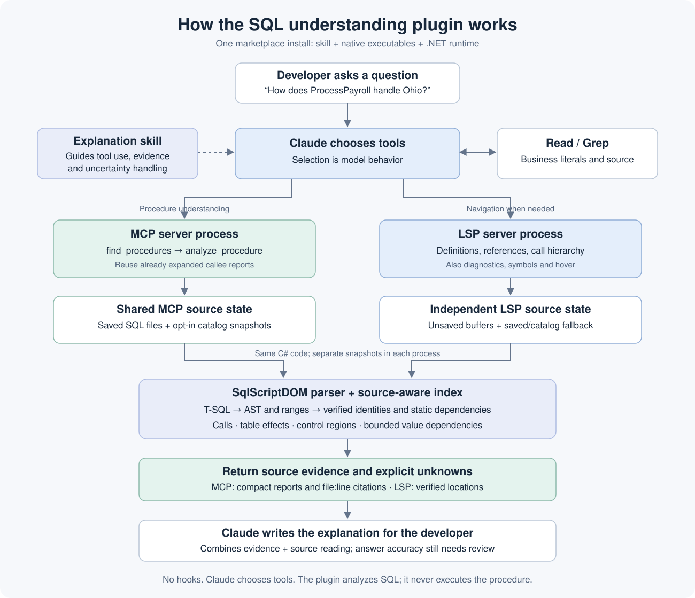
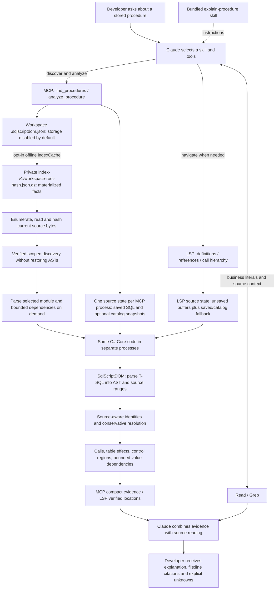

# How the plugin works

One platform-specific marketplace package contains the explanation skill, self-contained LSP/MCP executables, and the .NET runtime. Claude chooses the skill and tools for the developer's question. There are no hooks or Grep interceptors.

The two processes share implementation code, not live snapshots. MCP analyzes saved source; LSP can navigate unsaved edits. The analyzer resolves supported static SQL and reports ambiguity, unavailable bodies, dynamic SQL and budget limits. It does not execute the procedure or infer runtime values. Optional SQL Server access reads configured metadata only.

For a known file/module, Claude can call `analyze_procedure` directly with the file URI and declaration. Unknown locations use one scoped `find_procedures` page first. Short literal/script questions use Read/Grep. Claude can reuse callee facts, follow an OH predicate and argument bindings, and expand only relevant report pages. This is guidance rather than a fixed tool-call guarantee. The model writes the final explanation; successful analysis does not guarantee correct prose or citations.

The [compact report](compact-reports.md) shares source evidence and exposes ready-to-cite lines. An external, explicitly run [evaluation runner](procedure-analysis.md#measure-against-grepread) can collect request timings separately from task latency, tool calls, model usage and independently reviewed accuracy. There is no background metric collector.

Version 0.11.0 optionally saves canonical MCP reports as [private JSON files](persistent-analysis-cache.md). The MCP process validates the current loaded source context before reuse; LSP remains independent. The report cache does not restore the AST/navigation index.

Version 0.12.0 optionally records numeric MCP request metrics in bounded local JSONL. The get_metrics tool reads current/retained summaries without SQL initialization. A standalone client-CSV importer compares actual model usage captured by the evaluation runner; no model tokens are inferred by the backend. See [metrics](plugin-metrics.md).

Version 0.16.0 separately offers an opt-in [persisted discovery index](persistent-discovery-index.md). It saves SQL-derived facts as compressed JSON, verifies all current bytes before reuse and parses selected bodies on demand. This is independent of saved reports and the LSP process. [Bounded responses](bounded-analysis.md), [source scopes](offline-project-scopes.md) and [semantic observations](semantic-evidence.md) retain visible limits; measured speed/token outcomes remain in the [benchmark reports](plans/benchmark-improvement-progress.md).
